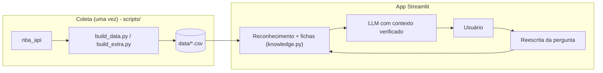

# 🏀 Hoops StatBot
[](https://github.com/dantas77-cloud/hoops-statbot/actions/workflows/tests.yml)

Chatbot de estatísticas e história da NBA que responde **fatos** com dados reais e **debates** (GOAT, melhor armador da história, caminho mais difícil até o título) com opinião fundamentada em números. Inspirado em ferramentas como o StatMuse.

> Projeto pessoal e educacional de quem gosta de basquete e de dados. **Sem vínculo com a NBA.** Este repositório não inclui dados, logos nem fotos da liga: leia o [AVISO_LEGAL.md](AVISO_LEGAL.md).
>
> **Disclaimer (EN):** This is an educational, non-commercial project for portfolio purposes. It is not affiliated with, endorsed or sponsored by the National Basketball Association (NBA) or any team. NBA-related names, data, logos and player images are the property of the NBA and their respective owners. This repository contains source code only: no NBA data, logos or photos are included, and images are disabled by default.

<!-- Demonstração: coloque aqui um GIF ou prints em docs/img/ (gravados com EXIBIR_IMAGENS_NBA=0, sem marcas de terceiros) -->

## Funcionalidades
- **Chat** com perguntas informais ("e o KD?", "quantos anéis o bron tem?"), memória da conversa e histórico salvo na lateral.
- **Explorador de Temporadas**: campeão, MVP, All-NBA, All-Defensive, All-Stars por conferência, classificação e caminho do título.
- **Rankings**: jogadores por época, posição e franquia; times por net rating; caminhos de título mais difíceis.
- **Líderes**: pontos, rebotes, assistências, roubos e tocos por temporada ou na carreira.
- **Comparador**: duelo entre dois jogadores com radar, estatísticas e veredito da IA.

## Como funciona (resumo)

O modelo de linguagem **só redige**; os fatos vêm de uma base local validada (RAG com recuperação estruturada, porque os dados são tabelas). Detalhes, decisões e roteiro de apresentação em [`docs/ARQUITETURA.md`](docs/ARQUITETURA.md).

## Como rodar
Requer Python 3.10+ e uma chave gratuita da [Groq](https://console.groq.com).

```bash
git clone <url-do-repositorio> && cd hoops-statbot
python -m venv .venv && source .venv/bin/activate      # Windows: .venv\Scripts\activate
pip install -r requirements.txt

cp .streamlit/secrets.toml.example .streamlit/secrets.toml   # coloque sua chave (arquivo ignorado pelo Git)

python scripts/build_data.py        # uma vez (retomável; leva um tempo)
python scripts/build_extra.py       # uma vez
python scripts/verificar_dados.py   # opcional: relatório de qualidade

streamlit run app.py
```
Sem a pasta `data/` preenchida, o app abre mas as abas de dados mostram um aviso pedindo os scripts acima.

### Opções (`.env` ou `.streamlit/secrets.toml`)
| Opção | Padrão | Efeito |
|---|---|---|
| `GROQ_API_KEY` | - | chave da API de IA |
| `EXIBIR_IMAGENS_NBA` | `0` | `1` mostra logos e fotos (uso pessoal e local; veja o aviso legal) |
| `NBA_HISTORICO` | `1` | `0` guarda conversas só na sessão (recomendado se publicar o app) |

## Testes
```bash
pip install pytest && pytest
```
Cobrem a interpretação de períodos ("anos 90", "1996"), a limpeza de HTML das respostas e as fichas de jogador (incluindo regressões de bugs reais: prêmio do Sporting News e da NBA Cup contados como MVP, e título atribuído ao jogador errado). A integração contínua roda os testes a cada push.

## Estrutura
```
app.py                 navegação, chat e comparador
components/            páginas: explorer, rankings, leaders
services/              knowledge (recuperação), llm_service, nba_service, conversas
utils/                 tema/CSS, config, logos e fotos (opcionais), limpeza de texto, gráficos
scripts/               coleta de dados, verificação de qualidade e checagem de publicação
tests/                 testes automatizados
docs/                  arquitetura, decisões e checklist de publicação
data/                  vazia no repositório; gerada localmente
```

## Limitações
- A API da NBA é **não oficial**, pode mudar e limita consultas; por isso os dados são baixados e salvos localmente.
- "Dificuldade do caminho" usa a força dos adversários na temporada regular, sem mando de quadra nem lesões.
- A API da NBA só informa Guard/Forward/Center; "armador" é inferido pelo perfil de assistências na carreira (aproximação).
- Estatísticas de playoffs por jogador vêm do `build_extra.py`; rankings "nos playoffs" usam títulos e MVP das Finais como critério.
- A pontuação de legado dos rankings é um critério transparente, mas subjetivo.
- O plano gratuito da Groq limita tokens por minuto; o app reduz o contexto e tenta de novo automaticamente.
- Não há versão hospedada: o `stats.nba.com` costuma bloquear provedores de nuvem e os Termos de Uso restringem a exibição pública do conteúdo.

## Antes de publicar uma alteração
Rode `python scripts/checar_publicacao.py` (ele procura chaves, dados e imagens no que iria para o GitHub) e siga o [checklist de publicação](docs/CHECKLIST_PUBLICACAO.md).

## Licença
Código sob [MIT](LICENSE). A licença não cobre dados, marcas ou imagens de terceiros ([AVISO_LEGAL.md](AVISO_LEGAL.md)).

---
**English summary:** Hoops StatBot is a personal NBA stats chatbot built with Streamlit. It uses structured retrieval over locally generated CSVs (collected via `nba_api`) and an LLM (Groq) that only writes answers from labeled facts, avoiding hallucinated awards and team/year mix-ups. This repo ships code only: no NBA data, logos or photos are included, and images are off by default. Not affiliated with the NBA.
