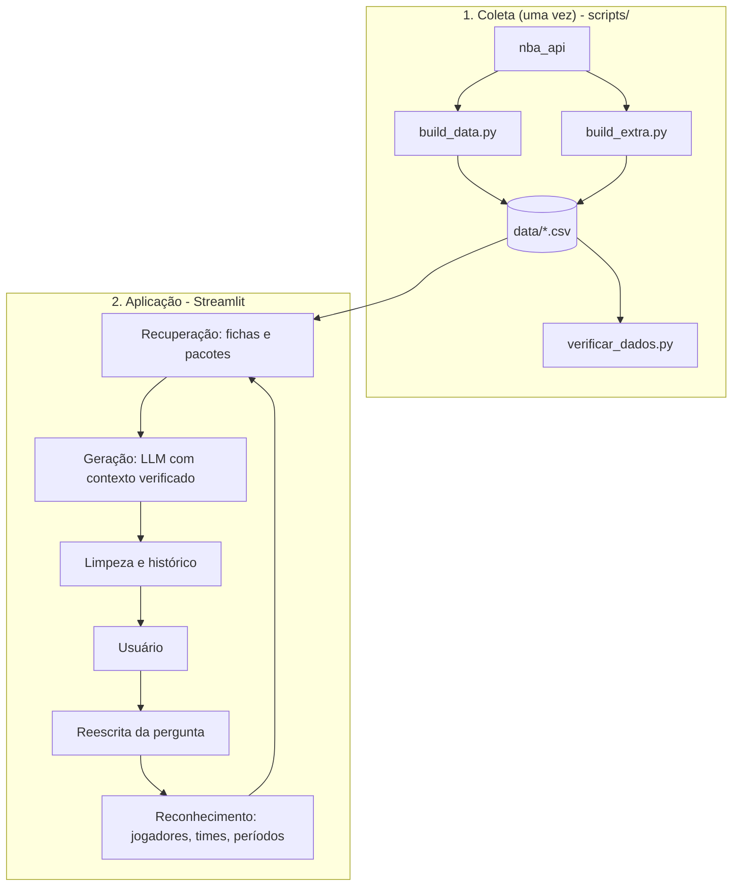

# Arquitetura do Hoops StatBot

Este documento explica como o projeto funciona por dentro: de onde vêm os dados, como uma pergunta vira uma resposta e por que o desenho foi feito assim.

## 1. Visão geral

O chatbot separa duas tarefas que um modelo de linguagem (LLM) sozinho faz mal:

| Tarefa | Quem faz | Por quê |
|---|---|---|
| **Saber os fatos** (campeões, All-NBA, estatísticas) | Base de dados local, vinda da API da NBA | LLMs erram anos, trocam times e inventam prêmios |
| **Escrever a resposta** (explicar, comparar, opinar) | LLM (Groq) | É o que ele faz bem |

Essa separação é uma forma de **RAG** (*Retrieval-Augmented Generation*, geração aumentada por recuperação): primeiro recupera-se o que é verdade, depois o modelo redige em cima disso.



## 2. Camadas

### 2.1 Coleta de dados (`scripts/`)
Roda uma vez. Consulta a API da NBA e salva CSVs em `data/`.

| Script | Gera | Endpoints |
|---|---|---|
| `build_data.py` | `players_index.csv`, `team_seasons.csv`, `awards.csv` | `PlayerIndex`, `LeagueStandingsV3`, `LeagueDashTeamStats`, `PlayerAwards` |
| `build_extra.py` | `player_team_seasons.csv`, `player_playoffs.csv`, `playoff_series.csv` | `PlayerCareerStats`, `LeagueGameFinder` |
| `verificar_dados.py` | relatório de qualidade | (lê os CSVs) |

Características de engenharia:
- **Retomável**: o progresso é salvo a cada 100 jogadores; se parar, continua de onde estava.
- **Paralelo e educado com a API**: 3 consultas simultâneas, com pausa entre elas.
- **Retentativas**: até 3 por consulta, e uma segunda passada nas que falharam.
- **Validação**: o relatório confere MVPs conhecidos e se cada temporada tem o número esperado de jogadores no All-NBA, All-Defensive e All-Star.

### 2.2 Recuperação (`services/knowledge.py`)
É o núcleo do projeto. Recebe a pergunta e devolve um texto de contexto com fatos rotulados.

1. `extrair_periodos()` transforma "1996", "2015-16" ou "anos 2010" em listas de temporadas.
2. `reconhecer()` acha jogadores por nome completo, apelido (`kd`, `bron`) ou sobrenome.
3. Detecta time (apelido da franquia) e posição (armador, ala, pivô).
4. Monta os pacotes:
   - `ficha_jogador()`: títulos com time e ano, MVPs, All-NBA, times por temporada, médias.
   - `pacote_temporada()` e `pacote_decada()`: campeão, MVP e times All-NBA, cada um rotulado.
   - `pacote_time()`: títulos e melhores temporadas da franquia.
   - `pontuar()`: ranking de legado por período, posição e franquia.
   - `caminhos_campeoes()`: força dos adversários de cada título.

### 2.3 Geração (`services/llm_service.py`)
- **Reescrita**: um modelo pequeno transforma a mensagem em pergunta completa, resolvendo "e o KD?" com o histórico.
- **Prompt do sistema**: regras como "só afirme sobre um jogador o que está na ficha dele" e "um time campeão não torna campeão todo jogador citado perto dele".
- **Controle de tokens** (`_montar`): histórico e contexto são cortados para caber no limite por minuto da Groq.
- **Resiliência**: erro 413 (pedido grande) refaz com versão enxuta; erro 429 (limite por minuto) espera o tempo indicado e tenta de novo.
- **Streaming**: a resposta aparece enquanto é gerada.

### 2.4 Interface (`app.py`, `components/`, `utils/`)
Streamlit com páginas de Chat, Explorador de Temporadas, Rankings, Líderes e Comparador. `utils/theme.py` concentra o CSS; `utils/logos.py` monta URLs de fotos e logos; `utils/texto.py` remove HTML que o modelo às vezes escreve.

## 3. Como o RAG funciona aqui

**RAG clássico** costuma usar *embeddings* e um banco vetorial para achar trechos de texto parecidos com a pergunta. Isso funciona bem para documentos. **Aqui os dados são tabelas** (prêmios, estatísticas), então a recuperação é **estruturada e determinística**: a pergunta é interpretada por regras e os fatos vêm de filtros em DataFrames.

| | RAG com embeddings | RAG estruturado (este projeto) |
|---|---|---|
| Ideal para | textos, manuais, artigos | tabelas, números, listas exatas |
| Como busca | similaridade semântica | filtros exatos (ano, jogador, prêmio) |
| Risco | trazer trecho parecido, mas errado | não entender uma pergunta fora do padrão |
| Como mitigamos | - | reescrita por LLM, apelidos, sobrenomes |

Exemplo, para "quem foi All-NBA em 2016?":

```python
# 1. período reconhecido: ["2015-16"]
# 2. consulta ao CSV (simplificada):
d = awards[awards.DESCRIPTION.str.contains("All-NBA") & (awards.SEASON == "2015-16")]
d = d.drop_duplicates(["PERSON_ID", "SEASON"])
# 3. agrupa por ALL_NBA_TEAM_NUMBER e vira texto:
#    "All-NBA 1º time: Stephen Curry, Kawhi Leonard, ..."
```

O LLM recebe esse texto e redige. Ele não precisa "lembrar" nada.

## 4. Consultas

### 4.1 À API da NBA (na coleta)
`nba_api` é uma biblioteca Python que envolve os endpoints HTTP do `stats.nba.com`. Cada classe de endpoint faz uma requisição GET com parâmetros e devolve JSON com cabeçalhos e linhas (`resultSets`). O método `get_data_frames()` converte isso em `pandas.DataFrame`.

```python
from nba_api.stats.endpoints import playerawards
r = playerawards.PlayerAwards(player_id=201142)   # Kevin Durant
df = r.get_data_frames()[0]                        # prêmios dele
```

Pontos de atenção:
- A API **não é oficial nem documentada**; colunas e respostas podem mudar.
- Ela limita consultas: daí as pausas, retentativas e o download retomável.
- Erros típicos: `ReadTimeout` (demorou) e `KeyError: 'resultSet'` (resposta vazia ou em formato inesperado, comum sob sobrecarga).
- A lista de jogadores (nomes e IDs) vem de `nba_api.stats.static`, que é embutida na biblioteca e não usa rede.

### 4.2 Aos CSVs (em tempo de execução)
`_csv()` lê os arquivos com `pandas` e guarda em cache (`st.cache_data`). As consultas são filtros por temporada, jogador (`PERSON_ID`), tipo de prêmio e time (`TEAM_ID`). Cuidados que garantem dados corretos:
- `_awd()` ignora prêmios que não são da NBA (Sporting News) e do torneio NBA Cup, e mantém um registro por jogador, temporada e prêmio.
- O time de um prêmio vem do time em que o jogador mais atuou naquela temporada.

### 4.3 À API do LLM (Groq)
Interface compatível com a da OpenAI (`chat.completions`). Cada chamada envia mensagens (sistema, histórico, pergunta com o contexto) e recebe texto em *streaming*. O plano gratuito limita **tokens por minuto**; por isso o tamanho do pedido é controlado e há retentativas.

## 5. Decisões e trade-offs

| Decisão | Motivo | Custo |
|---|---|---|
| Dados em CSV local | rápido, previsível, sem depender da API | precisa rodar os scripts para atualizar |
| Retrieval por regras | exato para dados tabulares | perguntas muito fora do padrão podem escapar |
| Fichas rotuladas | impede ligar jogador, time e ano errados | contexto maior (mitigado com limites) |
| Reescrita da pergunta | permite perguntas informais e sequenciais | uma chamada extra ao LLM |
| Pontuação de legado explícita | transparente e discutível | é um critério subjetivo |

## 6. Segurança e privacidade
- Chaves ficam em `.env` ou `.streamlit/secrets.toml`, ambos no `.gitignore`.
- O histórico local fica em `data/conversas.json` (também ignorado). Ao publicar o app, defina `NBA_HISTORICO=0` para guardar conversas só na sessão de cada visitante.
- Por padrão o app **não carrega logos nem fotos da NBA** (`EXIBIR_IMAGENS_NBA=0`); o modo com imagens é opcional, local e descrito no `AVISO_LEGAL.md`.
- Os CSVs gerados **não são versionados** (`.gitignore`): cada pessoa gera os seus localmente, respeitando os Termos de Uso do NBA.com.

## 7. Limitações
- API não oficial e sujeita a mudanças.
- "Dificuldade do caminho até o título" usa a força dos adversários na temporada regular, sem mando de quadra nem lesões.
- Base de jogadores por time cobre jogadores que receberam algum prêmio; jogadores sem prêmios não entram em Líderes e Rankings por time.
- Limite de tokens por minuto no plano gratuito do LLM.

## 8. Roteiro de apresentação (2 minutos)

**O problema (20 s).** "Eu gosto de basquete e de dados e queria um chatbot de NBA. Mas ao usar um LLM direto, ele errava anos, trocava times e inventava prêmios."

**A solução (40 s).** "Separei os fatos da redação. Baixei os dados da API da NBA e validei: confiro MVPs conhecidos e a completude de cada temporada. Quando alguém pergunta algo, o sistema reconhece jogadores, times e períodos, monta fichas com os fatos certos e só então o LLM escreve a resposta. Isso é RAG, mas com recuperação estruturada, porque meus dados são tabelas."

**Um desafio real (30 s).** "Os números dos MVPs saíam dobrados. Investigando, descobri que a base misturava prêmios de terceiros, como o Sporting News, e do torneio NBA Cup com o MVP oficial. Corrigi o filtro e criei um relatório de verificação para isso não voltar."

**Resultado e próximos passos (30 s).** "O app tem chat com memória de conversa, explorador de temporadas, rankings e comparador, e trata o limite de tokens da API. Como próximos passos, quero testes automatizados da camada de recuperação e mais estatísticas avançadas."

### Perguntas que podem surgir
- **Por que não usar embeddings?** Porque os dados são tabelas e exigem filtros exatos; similaridade semântica poderia trazer um ano parecido, mas errado.
- **Como evita alucinação?** O modelo só recebe fichas rotuladas e tem regras para não afirmar além delas; quando falta dado, ele diz que não tem.
- **Como lida com a API instável?** Baixa uma vez, salva em CSV, com retentativas e download retomável; o app não depende da API em tempo real.
- **O que faria diferente?** Testes automatizados desde o início e um cache de respostas.
